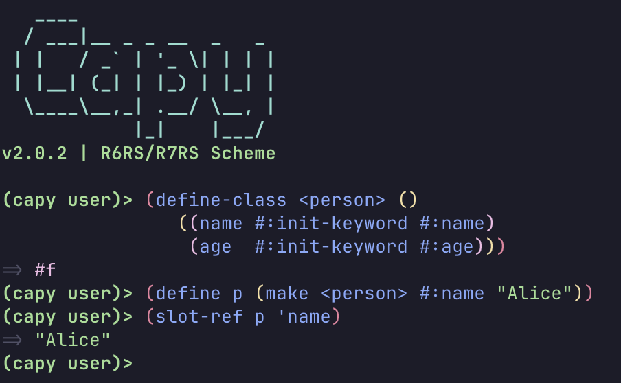

# CapyScheme

R6RS/R7RS compiler and runtime written in Rust.



# Capy 3.0.0

Capy 3.0.0 replaces the native code backend with a bytecode runtime.

- The compiler now produces bytecode instead of native code. The Cranelift backend, static basic block versioning (SBBV), and relocatable code blocks are gone.
- Code runs on a Rust interpreter or a template interpreter generated at startup, and hot procedures are compiled by a baseline JIT on worker threads.
- Faster startup: from ~50-80ms to ~16ms
- One of the fastest CLOS implementations: Capy now is able to inline cache slot accesses and generic dispatch in JIT/template interpreter and results in really quick accesses to CLOS slots. At the moment only SBCL MOP is faster than Capy.
- Rewritten I/O system: ports are no longer vendored from Larceny, we implemented our own port system with better memory management, and less overhead. `format`/`printf` calls are on average 10x faster and use 100-200B of heap memory instead of 12KiB. Another advantage is complete UTF-16 and UTF-8 support. 

# Performance

Capy v3 is on average 1.3x faster than Capy v2 across r7rs-benchmarks, but loop heavy math centric benchmarks are still faster on Cranelift AOT backend, this will be addressed in coming versions with new optimizing JIT tiers.

# Capy 3.\*.\* goals

For versions of Capy v3 there are goals to achieve, initial release of v3.0.0 is just a base that everything will be built on:
- Tier 2 JIT, Lazy Basic Block Versioning, and Tracing JIT: we have solid foundation for JIT, and integrating all 3 different compilation strategies
  is a nice research goal, plus users could choose a better suited JIT for their workloads in the future.
- Replace psyntax with syntax scopes model: Capy vendors in psyntax.scm and module system from Guile, while it is functioning fine it blocks us from doing separate compilation, static    linking, sandboxing via namespacing modules, and most importantly: locks Capy behind LGPL license. Syntax scopes model should give us simpler expander that is modular, fast, and will allow us
  to compile each Scheme file separately, or statically link a program (and in future compile it AOT to machine code).
- Introduce GC replacement API: Currently we explicitly only support MMTk, and it's worth making GC "pluggable" so experimentation on various algorithms is possible.


# Documentation

- [docs/IMPLEMENTATION.md](docs/IMPLEMENTATION.md): compiler pipeline, build system.
- [docs/BYTECODE.md](docs/BYTECODE.md): instruction set, frames, calls, engines.
- [docs/OBJECTS.md](docs/OBJECTS.md): values, classes, inline caches.
- [docs/JIT.md](docs/JIT.md): JIT pipeline and lazy edges.
- [docs/HEAP.md](docs/HEAP.md): garbage collector and rooting.
- [docs/SNI.md](docs/SNI.md): C and Rust native interface.
- [docs/BOOTSTRAP.md](docs/BOOTSTRAP.md): building and bootstrapping.

# R6RS/R7RS support

Most of R6RS and R7RS-small should be "just working" apart from some bugs. R6RS test-suite from [racket/r6rs](https://github.com/racket/r6rs) is used to guide development and at the moment 100% of tests are passing.

To run tests yourself:
```sh 
$ capy --r6rs -L . -s tests/r6rs/run-via-eval.sps
```

## Thanks

Big thanks to authors of [Loko](https://gitlab.com/weinholt/loko/), [Larceny](https://github.com/larcenists/larceny), [Guile](https://www.gnu.org/software/guile/) and [Ypsilon](https://github.com/fujita-y/ypsilon). CapyScheme uses stdlib parts from all of them and takes inspiration from them.
